# SubWatch — Design Notes

## 1. Idea

The first version of SubWatch flagged overlapping and unused subscriptions for
one person. That's what existing apps already do. This version moves to the
**household** level and treats "what you have access to" as something the
database has to *derive*, not just look up:

- Plans can include other plans (a telecom plan includes Amazon Prime, which
  includes Prime Video). That's a graph, and walking it finds duplicates that
  are invisible if you just compare service names.
- Plans have a member capacity, so the database can work out whether
  merging people onto a shared plan saves money, and check that nobody
  over-fills a plan.
- Usage is logged per member, so a shared plan's cost can be split by who
  actually uses it, and falling usage can be spotted before it hits zero.

Version 2 goes one step further. v1 reports findings one by one, and some of
them contradict each other (a bundle and a plain cancel can both claim the same
saving). v2 treats the household as one decision: find the cheapest set of
subscriptions that still gives every person what they use, simulate changes
before anyone makes them, and say how sure the system is about each finding.
Everything v1 computes still comes out the same. A snapshot of v1's output is
diffed after every change to prove it (section 15).

## 2. ER diagram

```mermaid
erDiagram
    HOUSEHOLDS ||--|{ HOUSEHOLD_MEMBERS : has
    USERS ||--o| HOUSEHOLD_MEMBERS : "belongs to"
    CATEGORIES ||--o{ SERVICES : groups
    SERVICES ||--|{ PLAN_CATALOG : offers
    PLAN_CATALOG ||--|{ PLAN_PRICE_HISTORY : "priced by"
    PLAN_CATALOG ||--o{ PLAN_INCLUSION_HISTORY : includes
    PLAN_CATALOG ||--o{ PLAN_INCLUSION_HISTORY : "is included in"
    USERS ||--o{ SUBSCRIPTIONS : pays
    PLAN_CATALOG ||--o{ SUBSCRIPTIONS : "bought as"
    SUBSCRIPTIONS ||--|{ SUBSCRIPTION_MEMBERS : "shared with"
    USERS ||--o{ SUBSCRIPTION_MEMBERS : "is member"
    SUBSCRIPTION_MEMBERS ||--o{ USAGE_LOGS : logs
    HOUSEHOLD_MEMBERS ||--o{ MEMBER_NEEDS : needs
    SERVICES ||--o{ MEMBER_NEEDS : "needed by"
    HOUSEHOLD_MEMBERS ||--o| USAGE_DATA_QUALITY : "checked for silence"
    HOUSEHOLDS ||--o{ ALERTS : receives
    PLAN_CATALOG ||--o{ ALERTS : "recommended in"
    ALERTS ||--|{ ALERT_SUBSCRIPTIONS : about
    SUBSCRIPTIONS ||--o{ ALERT_SUBSCRIPTIONS : "flagged in"
    ALERTS ||--o{ FINDING_EVIDENCE : "backed by"
    HOUSEHOLDS ||--o{ OPTIMIZATION_RUNS : "optimized in"
    OPTIMIZATION_RUNS ||--o{ OPTIMIZATION_STEPS : "made of"
    OPTIMIZATION_RUNS ||--o{ OPTIMIZATION_ALERT_OUTCOMES : decides
    ALERTS ||--o{ OPTIMIZATION_ALERT_OUTCOMES : "decided in"
    HOUSEHOLDS ||--o{ SCENARIOS : saves
    USERS ||--o{ STATEMENT_IMPORTS : uploads
    STATEMENT_IMPORTS ||--|{ BANK_TRANSACTIONS : contains
    SERVICES ||--o{ MERCHANT_ALIASES : "recognised by"

    USERS { int user_id PK
            string full_name
            string email UK
            string password_hash }
    HOUSEHOLDS { int household_id PK
                 string name
                 numeric monthly_budget }
    HOUSEHOLD_MEMBERS { int household_id PK
                        int user_id PK
                        string role }
    CATEGORIES { int category_id PK
                 string name UK
                 bool is_passive }
    SERVICES { int service_id PK
               string name UK
               int category_id FK }
    PLAN_CATALOG { int plan_id PK
                   int service_id FK
                   string name
                   string tier
                   string billing_cycle
                   int max_members
                   bool is_purchasable }
    PLAN_PRICE_HISTORY { int plan_id PK
                         date valid_from PK
                         numeric price
                         date valid_to
                         daterange valid_during "generated" }
    PLAN_INCLUSION_HISTORY { int parent_plan_id PK
                             int included_plan_id PK
                             date valid_from PK
                             date valid_to
                             daterange valid_during "generated" }
    SUBSCRIPTIONS { int subscription_id PK
                    int payer_id FK
                    int plan_id FK
                    date start_date
                    date end_date
                    string status }
    SUBSCRIPTION_MEMBERS { int subscription_id PK
                           int user_id PK }
    USAGE_LOGS { bigint usage_log_id PK
                 int subscription_id FK
                 int user_id FK
                 timestamptz used_at
                 int duration_minutes }
    MEMBER_NEEDS { int user_id PK
                   int service_id PK
                   string source
                   bool is_needed
                   timestamptz last_evidence_at }
    USAGE_DATA_QUALITY { int user_id PK
                         timestamptz last_logged_at
                         int days_silent
                         bool flagged }
    ALERTS { int alert_id PK
             int household_id FK
             string alert_type
             int recommended_plan_id FK
             string fingerprint
             text message
             numeric potential_monthly_savings
             string status
             string confidence
             bool counts_toward_savings "generated" }
    ALERT_SUBSCRIPTIONS { int alert_id PK
                          int subscription_id PK
                          string role
                          int_array reason_path }
    FINDING_EVIDENCE { bigint evidence_id PK
                       int alert_id FK
                       string evidence_type
                       string source_ref
                       text value
                       int weight }
    OPTIMIZATION_RUNS { int run_id PK
                        int household_id FK
                        string kind
                        string scenario_name
                        numeric cost_before
                        numeric cost_after
                        bool is_optimal
                        string state_hash
                        string status }
    OPTIMIZATION_STEPS { int run_id PK
                         int step_no PK
                         string action
                         int subscription_id
                         int plan_id
                         numeric saving
                         text reason
                         int_array reason_path
                         string confidence }
    OPTIMIZATION_ALERT_OUTCOMES { int run_id PK
                                  int alert_id PK
                                  string outcome }
    SCENARIOS { int scenario_id PK
                int household_id FK
                string name
                string change_type
                jsonb change_params }
    STATEMENT_IMPORTS { int import_id PK
                        int user_id FK
                        string file_name
                        timestamptz imported_at }
    BANK_TRANSACTIONS { bigint txn_id PK
                        int import_id FK
                        date txn_date
                        text description
                        numeric amount }
    MERCHANT_ALIASES { string pattern PK
                       int service_id PK }
```



**PLAN_INCLUSION_HISTORY** is a recursive (unary) relationship on PLAN_CATALOG:
both columns point at the plan table, one for "the plan that includes" and one
for "the plan that gets included". It started as the v1 table ENTITLEMENTS and
gained a date range, so an inclusion can start and end. Plans that are never
sold alone (e.g. "Prime Video, included with Prime") have `tier = 'included'`
and `is_purchasable = false`. Two views called `plans` and `entitlements` show
the rows valid today, so every v1 query still runs against the old names.

**MEMBER_NEEDS** hangs off HOUSEHOLD_MEMBERS (not off a subscription), because
a need has to stay put while the optimizer moves the person to a different
plan. **OPTIMIZATION_RUNS** also stores what-if runs (`kind = 'what_if'`).
Those can never be applied.

## 3. Normalization choices

- **Price lives with the plan, not the SUBSCRIPTION.** Every subscription to
  Spotify Family costs the same, so storing it per subscription would repeat
  data that depends on `plan_id`, not on `subscription_id` (a transitive
  dependency). In v2 it sits in PLAN_PRICE_HISTORY, keyed by `(plan_id,
  valid_from)`, so a price rise is a new row instead of an overwrite.
  `monthly_price` is still a generated column, so weekly/quarterly/yearly plans
  compare on one basis without anyone keeping a copy in sync.
- **Plan identity and plan price are separate tables.** Name, tier, capacity
  and cycle never change when the price does. Keeping them in PLAN_CATALOG
  means a price change doesn't touch (or duplicate) any of them.
- **MEMBER_NEEDS is keyed by `(user_id, service_id)`.** A need is a fact about a
  person and a service. It doesn't depend on which subscription currently
  provides the service, so it has no `subscription_id`.
- **FINDING_EVIDENCE is its own table.** A finding has several facts behind it
  (a coverage path, a price, a usage trend), so a column on ALERTS would break
  1NF. A `weight` per row lets the confidence rule be computed in SQL.
- **OPTIMIZATION_STEPS is a child of OPTIMIZATION_RUNS** with key `(run_id,
  step_no)`, so the order of steps is data, not an accident of row order.
- **Who shares a plan is its own table** (SUBSCRIPTION_MEMBERS) instead of a
  list column: 1NF.
- **USAGE_LOGS references SUBSCRIPTION_MEMBERS with a composite foreign key**
  `(subscription_id, user_id)`. Only an actual member of a subscription can
  log usage against it, and that's enforced by the schema, not app code.
- **ALERT_SUBSCRIPTIONS** is a junction table. One alert can be about any
  number of subscriptions (a family-plan suggestion involves 3 people's
  plans), and `role` says whether a subscription is the *subject* (cancel or
  merge this) or the *source* (the plan that explains it).
- **STATEMENT_IMPORTS has no household_id.** It follows from the user, so
  storing it would be a transitive dependency.
- **ALERTS** is the one deliberate exception: it stores the *output* of the
  detector views. That's so a dismissed alert stays dismissed. Each alert has
  a `fingerprint` (e.g. `dup:5`), and `refresh_alerts()` matches on it, so
  re-running the optimizer never resurrects something the user dismissed.

## 4. Rules enforced by triggers

These can't be written as CHECK constraints because they look at other rows
or other tables.

| Trigger | Rule |
|---|---|
| `trg_validate_subscription` | can't subscribe to a non-purchasable plan; payer must be in a household |
| `trg_enrol_payer` | the payer is automatically added as a member |
| `trg_check_member_rules` | a plan can't go over `max_members`; you can only share within the payer's household. Locks the subscription row (`FOR UPDATE`) so two people joining at the same time can't both take the last slot |
| `trg_protect_payer_membership` | the payer can't be removed from their own subscription (deleting the whole subscription still cascades fine) |
| `trg_check_plan_price` | a plan with `tier = 'included'` must have price 0 (it needs the plan's tier, which a CHECK on the price table can't see) |
| `trg_run_reconciles` (deferred) | at COMMIT, a run's step savings must add up to `cost_before - cost_after`, so a half-written run can't be saved |
| `validate_subscription` (extended) | refuses a plan with no price valid today |

Two v2 rules are plain constraints. `EXCLUDE USING gist` on both history tables
refuses overlapping date ranges. `CHECK (source = 'manual' OR is_needed)` on
MEMBER_NEEDS means only an owner's manual override can say "not needed".

## 5. How the detectors work

All of these are views in `db/detection.sql`, built on `v_subscription_detail`
(one row per subscription with plan, members and usage stats).

**Hidden duplicates — recursive CTE.** `v_entitlement_closure` walks the
entitlement graph from every plan, carrying the path as an array (which also
stops infinite loops if the graph ever had a cycle):

```sql
WITH RECURSIVE walk AS (
    SELECT plan_id AS root_plan_id, included_plan_id, 1 AS depth,
           ARRAY[plan_id, included_plan_id] AS path
    FROM entitlements
    UNION ALL
    SELECT w.root_plan_id, e.included_plan_id, w.depth + 1, w.path || e.included_plan_id
    FROM walk w JOIN entitlements e ON e.plan_id = w.included_plan_id
    WHERE e.included_plan_id <> ALL (w.path)
)
```

In v2 the same walk runs over PLAN_INCLUSION_HISTORY and also carries the
intersection of the date ranges along each path (section 10), so a path only
counts while every edge on it is valid. `v_plan_coverage` (a plan's own service
at depth 0, plus everything the closure reaches) is now the one traversal that
duplicates, bundles, needs and the optimizer all read.

A subscription is a hidden duplicate if another active subscription in the
household reaches the same service, **and every member of the duplicate is
also a member of the one that covers it**. That second part is a subset test
written as `NOT EXISTS (member of A who is NOT EXISTS in B)`. Depth 0 (being
on someone else's plan for the same service) counts too, with a tie-break so
two identical subscriptions don't each tell you to cancel the other.

**Family plan consolidation.** Group single-person plans by household and
service. For every shared tier, cost = `ceil(people / max_members) × price`;
`ROW_NUMBER()` picks the cheapest. That's why the Iyers get Spotify *Duo*
(₹149) while the Sharmas get *Family* (₹179 for 3, vs 2 × Duo = ₹298).

**Bundles — relational division.** For each purchasable plan, the closure
gives the set of services it unlocks. If it replaces 2+ of the household's
separate subscriptions for less money (and has enough member slots), it's
suggested. Whether the household already pays for *every* service in the
bundle is the classic division query:

```sql
NOT EXISTS (SELECT 1 FROM bundle_services bs
            WHERE bs.plan_id = c.plan_id
              AND NOT EXISTS (SELECT 1 FROM active a
                              WHERE a.household_id = c.household_id
                                AND a.service_id = bs.service_id))
```

**Usage falling — regression in SQL.** `v_usage_buckets` counts sessions in
six 30-day windows, using `generate_series` + `LEFT JOIN` so empty windows
count as 0 instead of disappearing. `v_churn_risk` fits a straight line with
`REGR_SLOPE` / `REGR_INTERCEPT` and flags a subscription if:

- it was really used (peak of 4 or more sessions in a window),
- it's dropping by at least 1 session per window,
- the line hits zero within 90 days,
- and it's still being used (fully dead ones are "unused" instead).

**Overlap.** Window functions rank the services in each category by recent
usage. The least used one is only flagged if it gets at most a quarter of the
top service's usage, so two equally loved apps aren't called "overlap".

**Fair share.** For each shared plan:
`share = price × (0.5 / members + 0.5 × my_minutes / total_minutes)`.
If nobody logged anything, it falls back to an equal split.

**Settle up.** `v_settle_up` sums what each person owes each payer. Then it
nets the two directions against each other, so A→B ₹400 and B→A ₹96 become
one transfer: A→B ₹304.

**Renewal forecast.** `renewal_forecast(household, days)` computes each
charge as `start_date + n × cycle`. It doesn't repeatedly add a month to the
previous date, so a plan that started on the 31st doesn't drift to the 28th.

## 6. Applying fixes (transactions)

`apply_alert(alert_id)` actually carries out a finding. Depending on the type,
it cancels the duplicate, joins the shared plan, starts a family plan or
bundle and moves everyone onto it, and so on. It returns the steps it took in
plain English. The API uses it two ways:

```
preview:  BEGIN → lock household → apply_alert() → read new totals → ROLLBACK
apply:    BEGIN → lock household → apply_alert() → read new totals → COMMIT
```

Because it's one transaction, a fix can never be half-applied. If any step
breaks a rule (say a trigger refuses a member because the plan is full),
everything already done in that transaction is undone too. The alert row is
locked `FOR UPDATE`, so applying the same fix twice at once is impossible: the
second attempt waits, then sees it's already resolved.

## 7. Concurrency: a deadlock we found and fixed

While testing, two fixes applied to the same household at the same moment
deadlocked (Postgres error `40P01`). Both transactions re-ran
`refresh_alerts()`, and the upsert into ALERTS touched the same rows in a
different order in each. T1 waited for a row T2 held while T2 waited for one
T1 held, a cycle, so Postgres killed one of them.

Fix: `lock_household()` takes a per-household advisory lock
(`pg_advisory_xact_lock`, released automatically at commit/rollback).
*Every* transaction that changes a household takes it first, before touching
any row: API changes, `apply_alert()` and `refresh_alerts()`. Same-household
changes now run one after another; different households still run in
parallel. When all households are locked at once, it's always in id order, so
no two lockers can wait on each other in a circle (consistent lock ordering).
After the fix, 5 stress runs of 22 simultaneous requests (applies, previews,
usage logs, refreshes) produced no deadlocks and no errors.

## 8. Performance: JIT

The first version of preview took about 14 s. `EXPLAIN ANALYZE` showed the
query itself took ~40 ms, and 13.2 s was **JIT compilation**: Postgres
compiling the query to machine code with LLVM before running it. The detector
views are nested several levels deep and the planner multiplies its row
estimates through each level, so it estimated a cost of ~42 million. That's
far above the JIT threshold, even though the real data is tiny. JIT only helps
large analytical scans, so it's switched off for the database (end of
`schema.sql`), for `refresh_alerts()` / `apply_alert()`, and on the API's
connections. Preview now takes about 0.06–0.15 s.

## 9. Bank statement import

Raw transactions go into BANK_TRANSACTIONS; the views do the rest.

1. **Clean up descriptions.** `normalize_merchant()` upper-cases them, turns
   punctuation into spaces and drops any token containing a digit (reference
   numbers, card digits). `UPI/DR/412345678/LANDLORD RENT/HDFC` becomes
   `UPI DR LANDLORD RENT HDFC`, keyed as `LANDLORD RENT`.
2. **Form series (gaps and islands).** Charges are grouped by merchant,
   amount, and roughly the same day of the month. Within a group, rows are
   sorted by day of month and a new "island" starts whenever the day jumps by
   more than 3, numbered with a running `SUM() OVER`. That's how two ₹99 Apple
   charges on the 3rd and the 22nd become two subscriptions instead of one
   "every 15 days" series.
3. **Check the cycle.** `LAG()` gives the gap between charges. Monthly needs
   3+ charges 25–35 days apart with a standard deviation of 3 days or less;
   quarterly and yearly need 2+. Food orders, cabs and electricity never
   qualify because the amount changes every time.
4. **Match to the catalog.** `MERCHANT_ALIASES` (regex) gives the possible
   services; amount + cycle pick the plan. When several subscriptions could
   match, the one billed nearest the same day of the month wins.
5. **Compare with what's tracked.** Each charge is labelled tracked,
   untracked, still charged (marked cancelled but the bank kept charging),
   cancelled (charges stopped), unknown plan, or not in catalog.

## 10. Prices and inclusions over time (FR-37)

Prices change and plans gain or lose bundled services, so v2 stores both as
date ranges. The v1 `plans` table became `plan_catalog` (what a plan is) and
the v1 `entitlements` table became `plan_inclusion_history`. Prices went into
`plan_price_history`. Each history row has `valid_from`, `valid_to` (NULL means
still valid) and a generated `valid_during` daterange. An exclusion constraint
stops two ranges for the same plan from overlapping:

```sql
EXCLUDE USING gist (plan_id WITH =, valid_during WITH &&)
```

A UNIQUE constraint can't do this, because two ranges with different start
dates can still overlap. It needs the `btree_gist` extension so the gist index
can compare a plain integer with `=` and a range with `&&` in the same
constraint. `schema.sql` creates the extension.

The views `plans` and `entitlements` show only the rows valid today, so every
v1 query, trigger and route works unchanged. Functions answer the same question
for any date: `plans_at(date)`, `entitlements_at(date)`,
`entitlement_closure_at(date)` and `household_spend_at(household, date)`. In
the closure, each step of the recursion keeps the intersection of the ranges
so far. A path is valid only while all of its edges are valid. The seed has
Netflix Premium going from ₹599 to ₹649 and an Airtel to Netflix inclusion that
has ended. The Sharma household costs ₹2,986.51 a month as of 100 days ago and
₹3,036.51 today. The dashboard's "spend on date" box shows this.

## 11. Needs (FR-28)

The optimizer can't decide what to cancel without knowing what each person
actually needs. `member_needs` records one row per person and service. Three
sources feed it:

- **usage:** the person used that service in the last 30 days, on any
  subscription. Cancelled subscriptions count, otherwise a need would vanish
  the moment the optimizer cancelled the plan it was logged on.
- **passive:** the person can reach a passive-category service (phone plan,
  cloud storage) through any active subscription, at any depth. These have no
  usage logs at all. Without this rule the optimizer would see them as unused
  and cancel them, and Apple One would stop covering iCloud+.
- **manual:** the owner adds or removes a need by hand. A manual "not needed"
  row suppresses the automatic one, and `refresh_member_needs()` never touches
  manual rows. `set_member_need(user, service, NULL)` goes back to automatic.

The needs are rebuilt inside `refresh_alerts()` under the household lock. The
view `v_need_coverage` says for each need whether it is covered today and by
which shortest path.

## 12. The household optimizer (FR-29 to FR-33)

**The problem.** Choose which plans the household holds and who is on each, so
that every need stays covered, no plan is over capacity and the monthly cost is
as low as possible. It is a weighted set cover with capacity limits.

**Where it runs.** The search is in Node (`server/optimizer.js`). SQL does the
parts it is good at: `optimizer_input(household)` returns the whole household
as one ordered JSON document (needs, subscriptions, candidate plans with the
services each covers and how, open findings), and `apply_optimization(run)`
carries out the answer.

**The search.** Branch and bound. It branches on the uncovered need that has
the fewest options, and each option is one of: join a kept plan that has a free
slot, keep a plan the person is already on, or start a candidate plan. Today's
setup is the first upper bound and a greedy pass tightens it. A branch is cut
as soon as its cost can't beat the best answer. The search stops at 1.5 s and
returns its best answer with `is_optimal = false`. Ties go to fewer changes,
then lower plan ids, so the same data always gives the same answer.

**Rules it follows.**

- Every need that is covered today stays covered.
- A passive subscription is only replaced by a plan that covers the same
  service for the same people. It is never just cancelled.
- It never adds a student plan (there is no eligibility data) or a service
  nobody uses today.
- No splitting: a service never ends up with more plans than it has today. This
  rules out replacing one shared Netflix Premium with four single-screen plans,
  which looks cheaper but is a worse product.
- A change must save at least ₹10 a month (`MIN_SAVING`), measured per
  dropped subscription by searching again with it kept. Without it the search
  swaps YouTube Premium Family (₹299) for two Individual plans (₹298) and makes
  three changes to save ₹1.
- A step that moves someone to a smaller tier is labelled "downgrade" in its
  reason and is never rated above Medium confidence.

**Output.** An ordered list of steps (start, switch, add member, cancel), each
with a plain-English reason, a reason path, a saving and a confidence. Each
open v1 finding is also labelled adopted, superseded or rejected. That settles
conflicts: Spotify Family and Spotify Duo can't both be right, and a bundle
and a cancel can't both claim the same saving.

| Household | Cost today | After | Saving | v1 findings alone |
|---|---|---|---|---|
| Sharma | ₹3,036.51 | ₹2,375.67 | ₹660.84 | ₹610.84 |
| Hostel A-412 | ₹1,126.67 | ₹841.67 | ₹285.00 | ₹285.00 |
| Iyer | ₹2,965.00 | ₹1,177.00 | ₹1,788.00 | ₹1,788.00 |

The extra ₹50 for Sharma is Dev's JioHotstar Super going to Mobile, because
nobody else on it has used it in 30 days. All three are solved exactly in under
60 ms.

**Applying a run.** `POST /optimize` stores the run with a `state_hash`, an md5
of the optimizer input. `apply_optimization(run)` takes the household lock,
then the run row `FOR UPDATE`. If the household has changed since the run was
computed (hash differs) it marks the run stale and refuses, and the page shows
"the household changed" with a Run again button. Otherwise it runs the steps
through the normal triggers, then checks that every need that was covered is
still covered, that no passive service was cancelled outright and that the new
cost equals the promised `cost_after`. If any check fails it raises and the
whole transaction rolls back. Preview is the same call followed by ROLLBACK, as
in section 6.

## 13. What-if simulator (FR-34 to FR-36)

A what-if asks "what happens if...?" without touching any data. The five
changes are: cancel a subscription, switch a plan, remove a member, remove an
inclusion and raise a price. `server/whatif.js` applies the change to an
in-memory copy of `optimizer_input()` and reports:

- the affected members and which services each loses,
- the coverage lost, split into needed (a real problem) and given up (the user
  chose it, e.g. they cancelled it themselves),
- the monthly cost change,
- the cheapest repair: the optimizer run on the changed copy, required to
  restore every need the change took away.

Example: Priya moves out of the Sharma household. Cost drops from ₹3,036.51 to
₹2,038.59, but Arjun, Meera and Dev lose Netflix and Dev also loses YouTube
Premium. The repair gives all four back and brings the cost to ₹2,225.67.

A repair may restart a passive plan of the same service, e.g. the phone plan
that left with the member who paid for it. Results are stored as `what_if`
runs, which `apply_optimization()` refuses. A saved scenario stores only the
change (`scenarios.change_params`). It is simulated again each time it is
opened, so it always reflects today's data, and the API says whether the
previous result is stale. Two scenarios can be compared side by side.

## 14. Confidence and evidence (FR-39 to FR-41)

Every finding stores the facts behind it in `finding_evidence`, each with a
weight:

| Evidence | Weight |
|---|---|
| coverage (the path that proves a duplicate) | 3 for a duplicate, 2 for a shared plan or bundle |
| price (the catalog price used) | 1 |
| usage (the trend or the days unused) | 1 or 2 |
| silence (the person has logged nothing for 45+ days) | -3 |

`v_finding_confidence` turns the rows into a level. Each evidence type counts
once, at its strongest row. A total of 3 or more is High, 2 is Medium, anything
less is Low, and any silence row makes the finding Low. The reason for the
silence rule: "unused for 60 days" means nothing if the person never logs
anything. A finding marked Low is kept out of "savings found" and out of a run's
counted saving. The page shows it muted under "worth a look". In the demo data
every finding is High or Medium, so the totals match v1. Make Vikram silent for
45 days and his LinkedIn finding (₹1,500) drops out, and Iyer's savings found
goes from ₹1,788 to ₹288.

## 15. Testing

Each phase has a script that runs on a scratch database and never touches the
working one:

| File | What it checks |
|---|---|
| `db/tests/regress.sh` | rebuilds a scratch database, snapshots everything v1 computes and diffs it against `v1_baseline/`. Run after every change. |
| `db/tests/v2a_check.sql` | history, coverage, needs, reason paths: 34 checks |
| `db/tests/v2b_check.js` | per household: never worse than v1's non-conflicting findings, no need left uncovered, nothing passive lost, no splitting, same answer on repeat, a failure injected in the last step leaves nothing changed: 28 checks |
| `db/tests/v2c_check.js` | 123 what-ifs leave all 18 live tables unchanged (row counts and hashes), every repair is replayed independently and re-covers every need: 22 checks |
| `db/tests/v2d_check.js` | the evidence and confidence rule, the 45-day silence, jit and locks on every new routine: 26 checks |
| `server/optimizer.test.js`, `whatif.test.js` | 20 unit tests, including agreement with an exhaustive search on 40 random households (`cd server && npm test`) |

**Benchmark (FR-42).** `node db/tests/benchmark.js` builds synthetic households
of a chosen size (members by subscriptions) inside a rolled-back transaction
and times v1 against the optimizer. On every household tried, v2 saved at
least as much as v1. Households with 5 members are solved exactly in well
under 2 s.

## 16. Limitations

- No real login yet. The API trusts the household/subscription id in the URL.
- Usage is logged by hand; nothing pulls it from the actual apps.
- Entitlement data and prices are sample values and would need to be
  maintained for real use.
- Bundles assume a household shares one account, which isn't true for every
  service.
- Statement import can't detect weekly charges, needs 13+ months of history
  for yearly ones, and splits a series in two if the price changes partway.
- "Savings found" adds up the concrete findings and is capped at total spend.
  Some suggestions are alternatives to each other, so a single finding list is
  an upper bound. The optimizer (section 12) fixes this by choosing one
  combination.
- **The exact search doesn't scale.** From about 10 members and 20
  subscriptions it hits its 1.5 s cap and returns the best valid answer it
  found, marked `is_optimal = false`. In the benchmark that answer still saved
  at least as much as v1, but the PRD's target (exact in under 2 s for 15
  members and 30 plans) isn't met. The problem is NP-hard in general. Next
  steps would be a stronger lower bound, splitting the problem by service where
  plans don't overlap, and caching repeated sub-problems.
- The optimizer can't see plan quality. A cheaper tier (Netflix Mobile instead
  of Premium) may be worse for the user, so downgrades are labelled and rated
  Medium at most. Student plans are never suggested because there is no
  eligibility data.
- Needs are inferred from the last 30 days of usage. Someone who only uses a
  service seasonally can look like they don't need it. The owner can add the
  need by hand.
- The confidence weights are our own judgement, written down in one place and
  tested, but not calibrated against real data.
