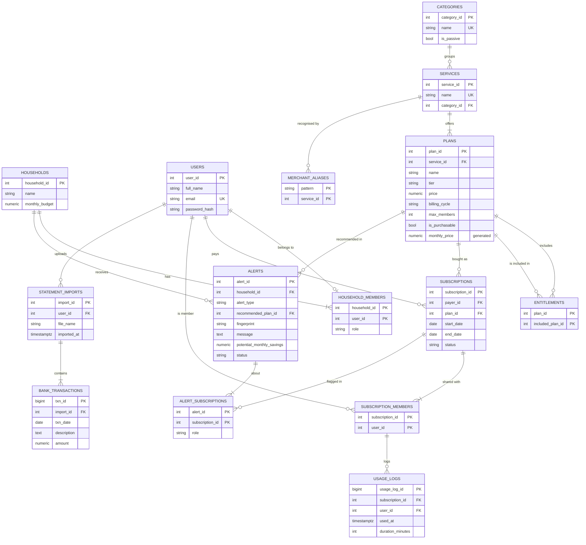

# SubWatch — Design Notes

## 1. Idea

The first version of SubWatch flagged overlapping and unused subscriptions for
one person. That's what existing apps already do. This version moves to the
**household** level and treats "what you have access to" as something the
database has to *derive*, not just look up:

- Plans can include other plans (a telecom plan includes Amazon Prime, which
  includes Prime Video). That's a graph, and walking it finds duplicates that
  are invisible if you just compare service names.
- Plans have a member capacity, so the database can work out whether
  merging people onto a shared plan saves money, and check that nobody
  over-fills a plan.
- Usage is logged per member, so a shared plan's cost can be split by who
  actually uses it, and falling usage can be spotted before it hits zero.

## 2. ER diagram



**ENTITLEMENTS** is a recursive (unary) relationship on PLANS: both columns
point at PLANS, one for "the plan that includes" and one for "the plan that
gets included". Plans that are never sold alone (e.g. "Prime Video, included
with Prime") have `tier = 'included'` and `is_purchasable = false`.

## 3. Normalization choices

- **Price lives on PLANS, not SUBSCRIPTIONS.** Every subscription to Spotify
  Family costs the same, so storing it per subscription would repeat data
  that depends on `plan_id`, not on `subscription_id` (a transitive
  dependency). `monthly_price` is a generated column, so weekly/quarterly/
  yearly plans compare on one basis without anyone keeping a copy in sync.
- **Who shares a plan is its own table** (SUBSCRIPTION_MEMBERS) instead of a
  list column: 1NF.
- **USAGE_LOGS references SUBSCRIPTION_MEMBERS with a composite foreign key**
  `(subscription_id, user_id)`. Only an actual member of a subscription can
  log usage against it, and that's enforced by the schema, not app code.
- **ALERT_SUBSCRIPTIONS** is a junction table. One alert can be about any
  number of subscriptions (a family-plan suggestion involves 3 people's
  plans), and `role` says whether a subscription is the *subject* (cancel or
  merge this) or the *source* (the plan that explains it).
- **STATEMENT_IMPORTS has no household_id.** It follows from the user, so
  storing it would be a transitive dependency.
- **ALERTS** is the one deliberate exception: it stores the *output* of the
  detector views. That's so a dismissed alert stays dismissed. Each alert has
  a `fingerprint` (e.g. `dup:5`), and `refresh_alerts()` matches on it, so
  re-running the optimizer never resurrects something the user dismissed.

## 4. Rules enforced by triggers

These can't be written as CHECK constraints because they look at other rows
or other tables.

| Trigger | Rule |
|---|---|
| `trg_validate_subscription` | can't subscribe to a non-purchasable plan; payer must be in a household |
| `trg_enrol_payer` | the payer is automatically added as a member |
| `trg_check_member_rules` | a plan can't go over `max_members`; you can only share within the payer's household. Locks the subscription row (`FOR UPDATE`) so two people joining at the same time can't both take the last slot |
| `trg_protect_payer_membership` | the payer can't be removed from their own subscription (deleting the whole subscription still cascades fine) |

## 5. How the detectors work

All of these are views in `db/detection.sql`, built on `v_subscription_detail`
(one row per subscription with plan, members and usage stats).

**Hidden duplicates — recursive CTE.** `v_entitlement_closure` walks the
entitlement graph from every plan, carrying the path as an array (which also
stops infinite loops if the graph ever had a cycle):

```sql
WITH RECURSIVE walk AS (
    SELECT plan_id AS root_plan_id, included_plan_id, 1 AS depth,
           ARRAY[plan_id, included_plan_id] AS path
    FROM entitlements
    UNION ALL
    SELECT w.root_plan_id, e.included_plan_id, w.depth + 1, w.path || e.included_plan_id
    FROM walk w JOIN entitlements e ON e.plan_id = w.included_plan_id
    WHERE e.included_plan_id <> ALL (w.path)
)
```

A subscription is a hidden duplicate if another active subscription in the
household reaches the same service, **and every member of the duplicate is
also a member of the one that covers it**. That second part is a subset test
written as `NOT EXISTS (member of A who is NOT EXISTS in B)`. Depth 0 (being
on someone else's plan for the same service) counts too, with a tie-break so
two identical subscriptions don't each tell you to cancel the other.

**Family plan consolidation.** Group single-person plans by household and
service. For every shared tier, cost = `ceil(people / max_members) × price`;
`ROW_NUMBER()` picks the cheapest. That's why the Iyers get Spotify *Duo*
(₹149) while the Sharmas get *Family* (₹179 for 3, vs 2 × Duo = ₹298).

**Bundles — relational division.** For each purchasable plan, the closure
gives the set of services it unlocks. If it replaces 2+ of the household's
separate subscriptions for less money (and has enough member slots), it's
suggested. Whether the household already pays for *every* service in the
bundle is the classic division query:

```sql
NOT EXISTS (SELECT 1 FROM bundle_services bs
            WHERE bs.plan_id = c.plan_id
              AND NOT EXISTS (SELECT 1 FROM active a
                              WHERE a.household_id = c.household_id
                                AND a.service_id = bs.service_id))
```

**Usage falling — regression in SQL.** `v_usage_buckets` counts sessions in
six 30-day windows, using `generate_series` + `LEFT JOIN` so empty windows
count as 0 instead of disappearing. `v_churn_risk` fits a straight line with
`REGR_SLOPE` / `REGR_INTERCEPT` and flags a subscription if:

- it was really used (peak of 4 or more sessions in a window),
- it's dropping by at least 1 session per window,
- the line hits zero within 90 days,
- and it's still being used (fully dead ones are "unused" instead).

**Overlap.** Window functions rank the services in each category by recent
usage. The least used one is only flagged if it gets at most a quarter of the
top service's usage, so two equally loved apps aren't called "overlap".

**Fair share.** For each shared plan:
`share = price × (0.5 / members + 0.5 × my_minutes / total_minutes)`.
If nobody logged anything, it falls back to an equal split.

**Settle up.** `v_settle_up` sums what each person owes each payer. Then it
nets the two directions against each other, so A→B ₹400 and B→A ₹96 become
one transfer: A→B ₹304.

**Renewal forecast.** `renewal_forecast(household, days)` computes each
charge as `start_date + n × cycle`. It doesn't repeatedly add a month to the
previous date, so a plan that started on the 31st doesn't drift to the 28th.

## 6. Applying fixes (transactions)

`apply_alert(alert_id)` actually carries out a finding. Depending on the type,
it cancels the duplicate, joins the shared plan, starts a family plan or
bundle and moves everyone onto it, and so on. It returns the steps it took in
plain English. The API uses it two ways:

```
preview:  BEGIN → lock household → apply_alert() → read new totals → ROLLBACK
apply:    BEGIN → lock household → apply_alert() → read new totals → COMMIT
```

Because it's one transaction, a fix can never be half-applied. If any step
breaks a rule (say a trigger refuses a member because the plan is full),
everything already done in that transaction is undone too. The alert row is
locked `FOR UPDATE`, so applying the same fix twice at once is impossible: the
second attempt waits, then sees it's already resolved.

## 7. Concurrency: a deadlock we found and fixed

While testing, two fixes applied to the same household at the same moment
deadlocked (Postgres error `40P01`). Both transactions re-ran
`refresh_alerts()`, and the upsert into ALERTS touched the same rows in a
different order in each. T1 waited for a row T2 held while T2 waited for one
T1 held, a cycle, so Postgres killed one of them.

Fix: `lock_household()` takes a per-household advisory lock
(`pg_advisory_xact_lock`, released automatically at commit/rollback).
*Every* transaction that changes a household takes it first, before touching
any row: API changes, `apply_alert()` and `refresh_alerts()`. Same-household
changes now run one after another; different households still run in
parallel. When all households are locked at once, it's always in id order, so
no two lockers can wait on each other in a circle (consistent lock ordering).
After the fix, 5 stress runs of 22 simultaneous requests (applies, previews,
usage logs, refreshes) produced no deadlocks and no errors.

## 8. Performance: JIT

The first version of preview took about 14 s. `EXPLAIN ANALYZE` showed the
query itself took ~40 ms, and 13.2 s was **JIT compilation**: Postgres
compiling the query to machine code with LLVM before running it. The detector
views are nested several levels deep and the planner multiplies its row
estimates through each level, so it estimated a cost of ~42 million. That's
far above the JIT threshold, even though the real data is tiny. JIT only helps
large analytical scans, so it's switched off for the database (end of
`schema.sql`), for `refresh_alerts()` / `apply_alert()`, and on the API's
connections. Preview now takes about 0.06–0.15 s.

## 9. Bank statement import

Raw transactions go into BANK_TRANSACTIONS; the views do the rest.

1. **Clean up descriptions.** `normalize_merchant()` upper-cases them, turns
   punctuation into spaces and drops any token containing a digit (reference
   numbers, card digits). `UPI/DR/412345678/LANDLORD RENT/HDFC` becomes
   `UPI DR LANDLORD RENT HDFC`, keyed as `LANDLORD RENT`.
2. **Form series (gaps and islands).** Charges are grouped by merchant,
   amount, and roughly the same day of the month. Within a group, rows are
   sorted by day of month and a new "island" starts whenever the day jumps by
   more than 3, numbered with a running `SUM() OVER`. That's how two ₹99 Apple
   charges on the 3rd and the 22nd become two subscriptions instead of one
   "every 15 days" series.
3. **Check the cycle.** `LAG()` gives the gap between charges. Monthly needs
   3+ charges 25–35 days apart with a standard deviation of 3 days or less;
   quarterly and yearly need 2+. Food orders, cabs and electricity never
   qualify because the amount changes every time.
4. **Match to the catalog.** `MERCHANT_ALIASES` (regex) gives the possible
   services; amount + cycle pick the plan. When several subscriptions could
   match, the one billed nearest the same day of the month wins.
5. **Compare with what's tracked.** Each charge is labelled tracked,
   untracked, still charged (marked cancelled but the bank kept charging),
   cancelled (charges stopped), unknown plan, or not in catalog.

## 10. Limitations

- No real login yet. The API trusts the household/subscription id in the URL.
- Usage is logged by hand; nothing pulls it from the actual apps.
- Entitlement data and prices are sample values and would need to be
  maintained for real use.
- Bundles assume a household shares one account, which isn't true for every
  service.
- Statement import can't detect weekly charges, needs 13+ months of history
  for yearly ones, and splits a series in two if the price changes partway.
- "Savings found" adds up the concrete findings and is capped at total spend.
  Some suggestions are alternatives to each other (bundle vs. dropping the
  least-used app), so it's an upper bound.
